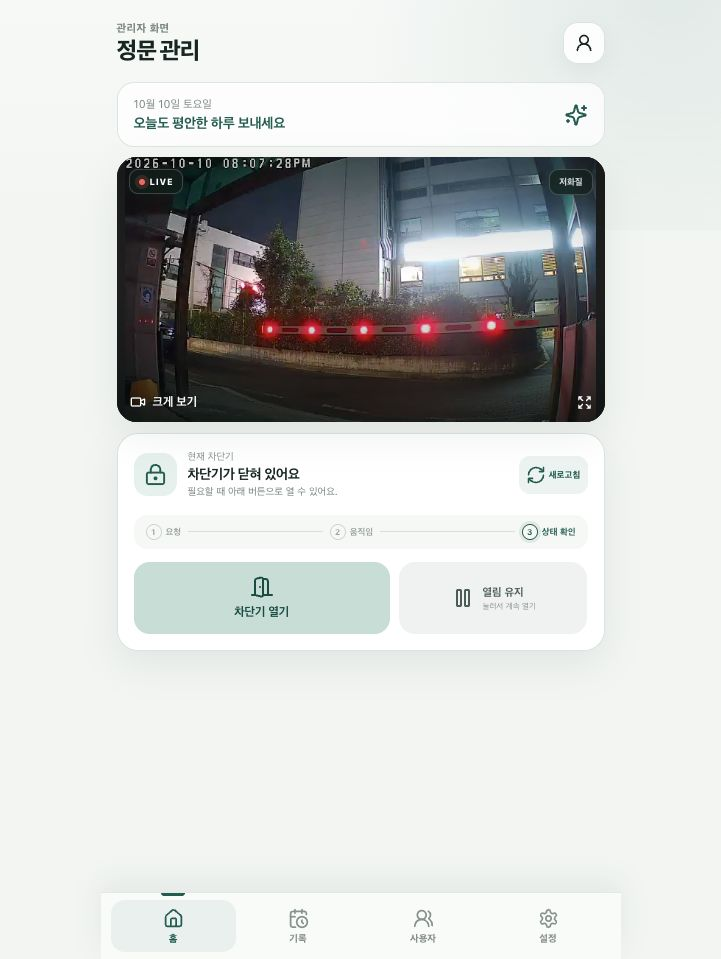
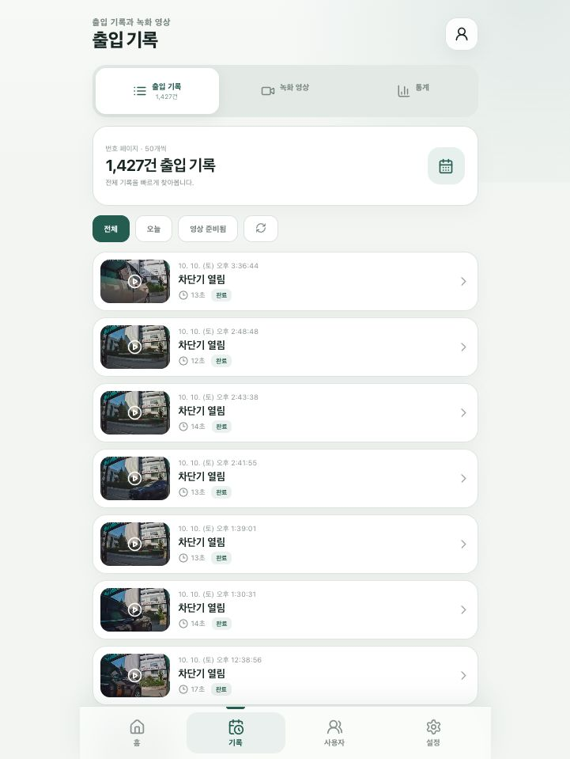
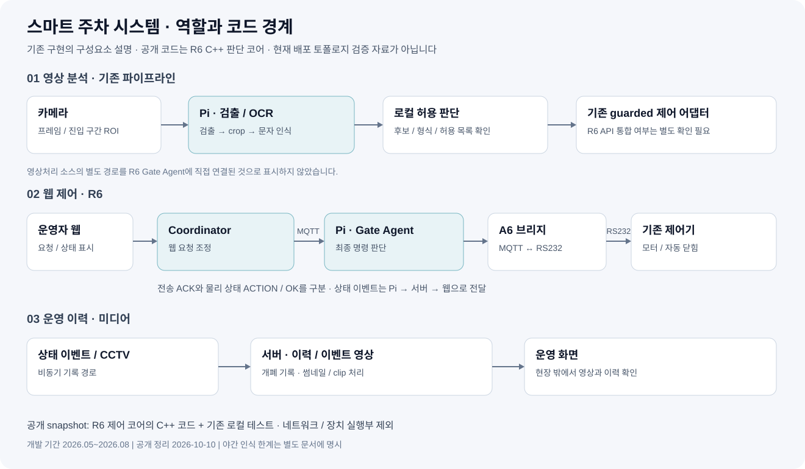

# 스마트 주차 시스템

기존 차단기에 원격 제어와 CCTV 확인 기능을 연결한 프로젝트입니다. 관리자 웹에서 장치 상태와 개폐 이력을 확인하고, Raspberry Pi에서는 번호판 검출과 OCR을 거쳐 차량의 허용 여부를 판단하도록 구성했습니다.

- 개발 기간: 2026.05 ~ 2026.08
- 담당: 요구사항·장비 선정, RS232·MQTT 연동, 서버·관제 웹 연결, 번호판 인식 적용
- 기술: C++20, Python, OpenCV, ONNX Runtime, MQTT, RS232, Linux, Raspberry Pi

## 관제 화면

<p>
  
  
</p>

| 화면 | 기능 |
|---|---|
| 실시간 관제 | CCTV 영상, 차단기 상태, 원격 제어 |
| 출입 기록 | 날짜·영상 유무별 조회, 썸네일과 개폐 시각 확인 |
| 기록 상세 | 개폐 이벤트에 연결된 영상과 열림·닫힘 시각 확인 |

기록은 차단기 개폐 이벤트 기준입니다. 차량별 입출차 매칭이나 주차시간 정산 기능과는 구분합니다.

## 시스템 구조



| 구성 | 역할 |
|---|---|
| 서버 Coordinator | 웹 요청 검증, 중복 요청 조정, 상태 전달 |
| Pi Gate Agent | 장치로 보낼 명령의 최종 판단과 상태 처리 |
| A6 보드 | MQTT 메시지와 RS232 바이트 전달 |
| 기존 차단기 제어기 | 모터 구동, 자동 닫힘, 센서·리모컨 입력 |

번호판 인식 경로와 R6 원격 제어 코어는 별도 구현으로 정리했습니다. 두 경로의 연결 지점은 [시스템 구조](docs/architecture.md)에서 설명합니다.

## 주요 구현

### 서버 요청과 장치 명령 처리 분리

서버의 [`CoordinatorCore`](coordinator/src/coordinator_core.cpp)는 웹 요청을 조정합니다. Pi의 [`AgentCore`](edge-agent/src/agent_core.cpp)는 장치 상태와 명령 유효시간을 확인하고 실제 전송할 명령을 결정합니다. 같은 방향의 요청은 진행 중인 동작에 합류시키며 중복 전송을 제한합니다.

### 전송 응답과 실제 동작 상태 구분

A6가 명령을 전달했다는 ACK와 차단기가 실제로 열린 상태를 따로 처리합니다. [`a6_codec.cpp`](edge-agent/src/a6_codec.cpp)에서 RS232 응답을 해석하고, 코어에서 전송 상태와 물리 상태를 갱신합니다. 기존 리모컨으로 움직인 경우에도 장치의 현재 상태를 기준으로 처리합니다.

### 번호판 검출과 OCR 연결

영상 처리 흐름은 다음과 같습니다.

```text
진입 구간 ROI → 번호판 검출 → 번호판 영역 crop → OCR → 후보 확인 → 허용 판단
```

OpenCV와 ONNX Runtime을 사용해 검출 영역 추출, OCR 입력 전처리, 문자 후보 복원을 연결했습니다. 도로의 모든 차량을 처리하지 않도록 진입 구간에 ROI를 설정했습니다.

야간에는 조도와 모션블러 문제로 자동 인식을 사용하지 않습니다. 적외선 장치나 셔터 성능이 좋은 카메라의 도입을 검토 요청한 상태입니다.

[영상처리 코드와 ROI 설명](docs/vision-pipeline.md)

## 디렉터리

```text
protocol/     명령·상태 메시지 타입과 JSON 변환
coordinator/  서버의 요청 조정 코어
edge-agent/   Pi 제어 코어와 A6 응답 파서
tests/        상태 전이, ACK 처리, 동시 요청 테스트
docs/         시스템 구조, 영상처리 코드, 검증 기록
```

## 빌드와 테스트

C++20 컴파일러, CMake 3.20 이상, `nlohmann_json`이 필요합니다. 네트워크나 실제 장치에 연결하지 않고 제어 코어를 테스트합니다.

```bash
cmake -S . -B build -DCMAKE_BUILD_TYPE=Debug
cmake --build build --parallel
ctest --test-dir build --output-on-failure
```

## 저장소 범위

이 저장소에는 C++ 제어 코어, 메시지 계약, 프로토콜 파서와 테스트를 포함했습니다. 관제 웹·미디어 서비스·통신 실행부는 구조로 설명하고, 번호판 인식 코드는 문서에 발췌했습니다. 운영 설정, 인증정보, 원본 차량 영상, 데이터셋과 모델 가중치는 제외했습니다.

[코드 안내](docs/code-map.md) · [테스트 결과와 남은 과제](docs/limitations.md)
