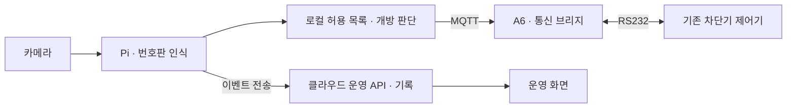

# 주차 차단기·번호판 인식 시스템

카메라 영상의 번호판 인식부터 Raspberry Pi의 허용 판단, MQTT와 A6 보드를 통한 차단기 제어까지 연결한 현장 시스템입니다.
이 저장소에서는 장치 제어와 인식 AI의 데이터·학습·평가 과정을 함께 소개합니다.

> 포트폴리오 README 초안입니다. 현재는 시스템 구성과 정리 범위를 공개하며, 핵심 코드·촬영 조건·평가 자료는 근거 확인 후 보완합니다.

## 시스템 구성

| 구성 | 책임 |
| --- | --- |
| Raspberry Pi | 번호판 인식, 로컬 허용 판단, 명령 검증·직렬화, 현장 이벤트 기록 |
| KC868-A6 | MQTT 메시지와 RS232 통신 사이의 전달 |
| 기존 차단기 제어기 | 실제 모터 동작, 정상 자동 닫힘과 물리적 보호 기능 |
| 클라우드 | 운영 화면, 이벤트 저장, 영상·썸네일 처리 |

## 장치 제어

### 현장 판단과 원격 운영 분리

자동 개방 판단은 Pi가 담당합니다. 현장 장비와 통신이 정상이라는 조건에서 클라우드 연결이 끊겨도 로컬 판단 경로를 유지하도록 구성했습니다.

### 기존 차단기와의 통신

A6를 MQTT–RS232 브리지로 사용해 기존 제어기의 명령·응답 프로토콜과 연결했습니다. A6가 번호판을 판단하거나 모터를 직접 제어하는 구조는 아닙니다.

### 전송 결과와 물리 상태 구분

명령 전송 ACK와 차단기의 실제 동작·완료 응답을 구분합니다. 중복 요청, 동시 요청, 응답 시간 초과 상황을 제어 서비스에서 다룹니다.

## 번호판 인식 AI

현장 영상의 번호판 검출·문자 인식과 허용 판단을 연결했습니다. 학습 설명은 실제 사용한 데이터와 코드, 평가 기록을 기준으로 보완합니다.

### 데이터셋·촬영 환경

공개 문서에는 아래 항목을 구체적으로 설명할 예정입니다. 아직 확인하지 않은 값은 임의로 기입하지 않았습니다.

| 항목 | 기록할 내용 |
| --- | --- |
| 카메라 | 모델명, 촬영 해상도, 프레임 조건 |
| 공간 조건 | 카메라 높이·각도·거리, 차량 접근 방향 |
| 영상 특성 | 번호판 크기, 조명·역광, 흔들림과 가림 |
| 데이터 구성 | 수집·선별 기준, 라벨링, 학습·평가 분리 방식 |
| 예시 | 번호판과 개인 식별 요소를 비식별 처리한 이미지 |

데이터셋 원본과 실제 위치는 공개하지 않습니다.

### 학습·평가 설명

- 실제 학습에 사용한 모델과 핵심 코드
- 전처리와 데이터 구성에서 내린 판단
- 비교 조건이 명확한 평가 결과
- 오인식 사례와 적용 한계

번호판 검출, 문자 인식, 실제 개방 판단은 구분해 설명합니다. 모델 confidence를 정확도로 표기하지 않습니다.

## 사용 기술

C++, Python, Raspberry Pi, ESP32/KC868-A6, MQTT, RS232, OpenCV, Linux.

## 공개 범위

특정 시점의 구현을 선별한 포트폴리오입니다. 운영 원본의 구조는 변경하지 않습니다.
A6 관리용 HTML 구현은 공개 코드에서 생략하고 해당 위치에 주석으로 표시할 예정입니다.
인증정보, 운영 주소·로그, 데이터셋 원본은 포함하지 않습니다. 전체 시스템 배포·실행을 위한 패키지는 제공하지 않습니다.

[개발자 프로필](https://github.com/shear99)
