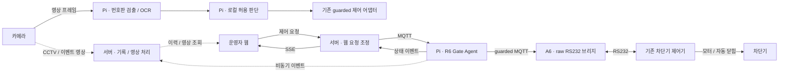
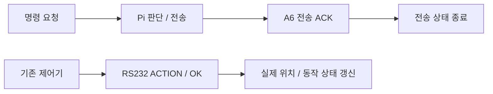

# 시스템 구조

아래는 기존 시스템의 역할 경계입니다. 저장소에 포함된 코드는 이 중 Coordinator·Pi 제어 코어와 프로토콜 계층입니다. 각 상자가 모두 이 저장소에서 실행되는 것은 아닙니다. 웹 제어 R6와 기존 영상처리 구현은 서로 다른 소스 경계로 표시합니다. 현재 운영에서 두 경로가 어떤 설정으로 연결되어 있는지는 이 공개 작업에서 확인하지 않았습니다.

## 1. 웹 실시간 제어 경로 · R6

1. 웹 제어 요청은 서버 Coordinator에 도착합니다. 인증·권한을 확인하는 실행 어댑터와 순수 제어 코어는 서로 다른 책임입니다.
2. Coordinator 코어가 요청의 중복 여부, 현재 상태, 진행 중 동작을 확인합니다.
3. Pi Agent가 모든 제어 요청을 최종 조정합니다. 전송 대상 장치의 boot ID, TTL, 현재 상태를 확인하고 같은 방향 요청을 합칩니다.
4. 실행부가 전송 전 기록을 남기고 A6에 MQTT 명령을 전달합니다. A6는 RS232 바이트를 기존 제어기로 전달합니다.
5. 기존 제어기의 물리 상태가 RS232 → A6 → Pi → 서버 → 웹으로 돌아옵니다.

공개 코어는 2~3번의 판단과 5번의 상태 해석을 로컬에서 살펴보도록 선별했습니다. HTTP·MQTT 연결, 인증, 전송 전 기록의 실제 저장 실행부는 포함하지 않습니다.

## 2. 인식 경로

- Pi의 영상처리 경로에서 번호판 검출과 OCR을 연결합니다.
- 결과의 형식·후보를 확인하고 로컬 허용 목록과 연계합니다.
- 기존 영상처리 코드에는 `a6_rs232_raw`와 `gate_command_service` 제어 어댑터가 있습니다. 이 경로가 R6 Gate Agent API와 단일화됐다고 표시하지 않습니다.
- 인식 결과를 물리 모터 신호와 동일시하지 않고, 허용 판단과 guarded 명령 구성 단계를 구분합니다.
- ROI는 필요한 진입 구간으로 관심 영역을 제한하는 현장 설정입니다. 새로운 검출 모델을 개발하거나 야간 성능을 해결한 것으로 설명하지 않습니다.

## 3. 전송 결과와 실제 상태

ACK는 전송 경로의 결과입니다. 실제 위치는 별도의 `ACTION/OK` 응답으로 갱신합니다. 리모컨이나 기존 센서 입력 때문에 움직일 수도 있으므로, 물리 상태에 웹 명령의 원인을 임의로 붙이지 않습니다. 전송 lock과 진행 중 동작 상태도 별개로 유지합니다.

## 4. 영상·기록 경로

제어와 별도로 이벤트를 서버에 전달하고 운영 이력·썸네일·이벤트 영상을 조회할 수 있도록 구성했습니다. 기록·미디어 처리의 지연을 장치 명령의 전제조건으로 삼지 않는 것이 설계 의도입니다. 이 저장소에는 미디어 서비스와 운영 DB를 넣지 않았으며, 장애 상황의 전체 시스템 가용성을 로컬 테스트 결과로 주장하지 않습니다.

## 5. 현장 장치의 책임

| 구성 | 책임 |
|---|---|
| Pi | 영상처리·로컬 허용 판단, 최종 명령 조정, RS232 상태 해석 |
| A6 | MQTT와 raw RS232 사이의 전달 |
| 기존 제어기 | 물리 모터 동작, 정상 자동 닫힘, 기존 센서·리모컨 입력 |
| 서버 | 웹 요청 조정, 상태 전달, 비동기 기록·미디어 |

센서·리모컨·자동 닫힘을 이 프로젝트의 AI나 자체 모터 제어 구현 성과로 포함하지 않습니다.
